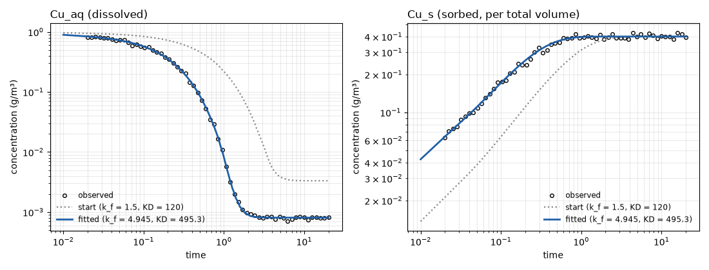

# Case 1: batch sorption and desorption

From `Batch_sorption_desorption.ohq`. A single groundwater cell holds copper in
two phases, aqueous (`Cu_aq`) and sorbed (`Cu_s`), exchanging by first-order
kinetics:

    sorption     rate = k_f * Cu_aq
    desorption   rate = (k_f / KD) * Cu_s

`Cu_aq` is a dissolved constituent (per volume of water) and `Cu_s` a sorbed
constituent, expressed per total volume of the cell, so `KD` is the
dimensionless ratio of the two at equilibrium (for linear sorption it equals
rho_b*K_d). Both reactions are Chemical reactions with stoichiometric constants
-1 and +1, which conserves mass: `Cu_aq:mass + Cu_s:mass` stays at 0.4 g.

Starting from 1 g/m3 dissolved (0.4 g in 0.4 m3 of water) and nothing sorbed,
the aqueous concentration decays at the rate k_f*(1 + n/KD) = 5.004 per unit
time (timescale 0.2) and levels off by about t = 2 at
n*C0/(n + KD) = 0.4/500.4 = 8.0e-4, where Cu_s / Cu_aq = KD and Cu_s = 0.40.

**Corrected 2026-11-08.** Earlier versions gave `Cu_s` the stoichiometric
constants +-porosity/rho, which do not conserve mass: about 99.9 % of the copper
disappeared, so `Cu_aq` fell to a spurious plateau near 2.3e-7. The data files
were regenerated from the corrected `truth.ohq` with `make_observations.py`.

## The estimation problem

| Parameter | Truth | Start | Range | Searched in |
|---|---:|---:|---|---|
| `p_k_f` | 5.0 | 1.5 | 0.1 to 50 | log10 |
| `p_KD` | 500 | 120 | 10 to 5000 | log10 |

The two are informed by different parts of the curve, which is what makes the
case well conditioned: **k_f** by the early decay rate, **KD** by the height of
the equilibrium plateau. Their fitted correlation is only -0.08.

Observations are `Cu_aq:concentration` and `Cu_s:concentration`, 60 points each,
log-spaced from t = 0.02 to 20, with 5% multiplicative noise and a log-normal
error structure. Both `error_standard_deviation` values are fixed at the true
noise level of 0.05, so the confidence intervals are directly checkable.

## Observed and modelled

Both axes are logarithmic: the aqueous concentration falls through three decades
and the sampling is log-spaced in time, so a linear axis would pile every point
against the origin.

## Result

**Not yet re-run with OHQ-LM after the correction.** The numbers previously
shown here (k_f = 5.012, KD = 511.2) came from the mass-losing model and no
longer apply. Run `OHQ-LM calibration.ohq . --threads 4` and record the result.

As an independent check on the corrected case, a log-space least-squares fit
(SciPy's Levenberg-Marquardt, with OHQTerminal as the forward model, same data,
same starting values and noise level) gave

    k_f = 4.945   (truth 5.0)    95% CI [4.907, 4.983]
    KD  = 495.3   (truth 500)    95% CI [484.9, 506.0]

with a correlation of -0.14, in 24 model runs. The k_f interval just misses the
truth for this noise realisation; on five other realisations both intervals
covered the truth (k_f from 4.990 to 5.028, KD from 495.7 to 504.5).

## A note on the solver setting

This case overrides the source model's `nr_tolerance`, raising it from 1e-3 to
1e-10, and `minimum_timestep` from 1e-6 to 1e-9.

`Cu_aq` falls through three decades to a plateau at 8.0e-4, below the shipped
absolute tolerance of roughly 1e-3, and KD is identified by exactly that
plateau. (In the earlier, mass-losing version of this case the plateau was at
2.3e-7; at the shipped tolerance everything there was numerical noise, and LM
returned k_f = 3.92 against a truth of 5.0, with confidence intervals that
excluded the true value. The fit looked converged and the diagnostics looked
healthy.)

Any quantity whose informative range extends far below the solver tolerance has
this problem, and it is invisible unless you check the likelihood at known
parameter values. That is what `at_truth.ohq` is for.
